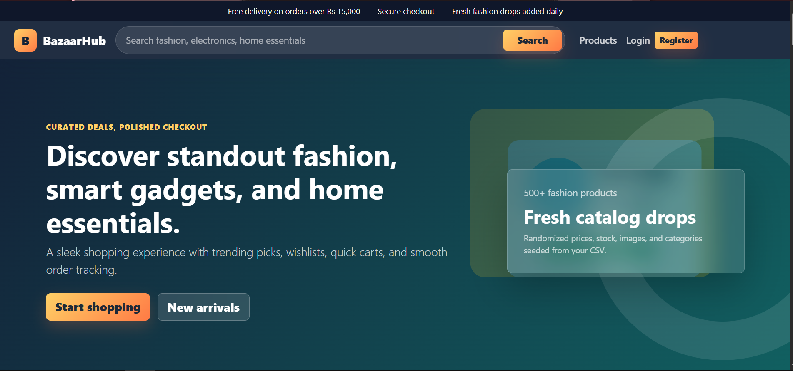
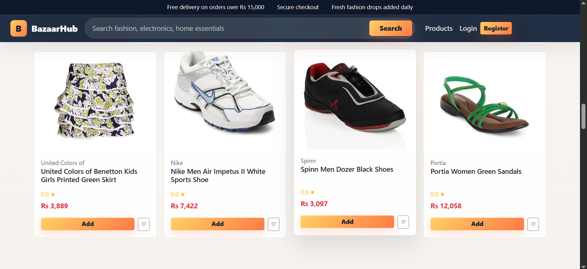
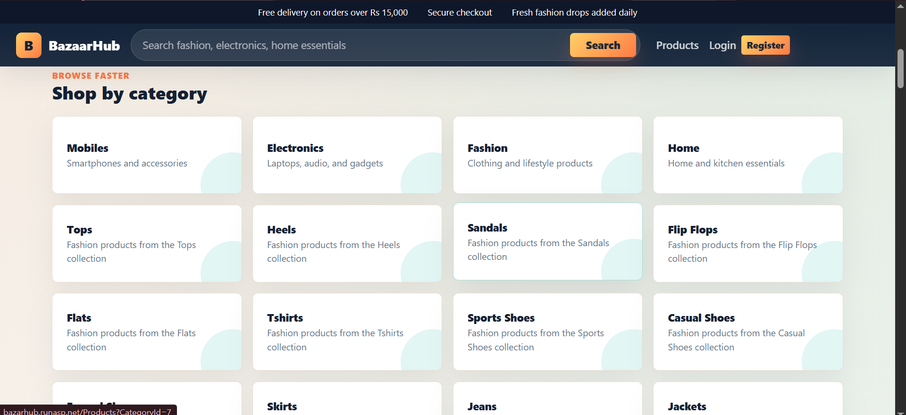
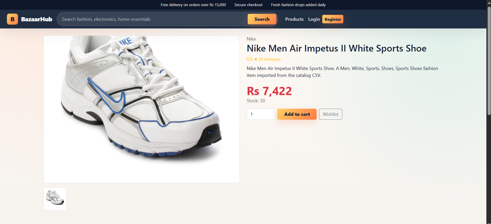

# 🛍️ BazarHub - E-Commerce Web Application

[](https://dotnet.microsoft.com/)
[](https://getbootstrap.com/)
[](https://www.microsoft.com/sql-server)
[](http://bazarhub.runasp.net/)

> **BazarHub** is a production-grade e-commerce web application inspired by leading global marketplaces like Amazon and Daraz. Built with **.NET 10 ASP.NET Core MVC**, **Entity Framework Core**, **SQL Server**, and **ASP.NET Core Identity**, featuring a clean layered architecture (Repository & Service patterns), an intuitive customer storefront, and a feature-rich admin dashboard.

---

## 🌐 Live Demo

Visit the deployed live application: [http://bazarhub.runasp.net/](http://bazarhub.runasp.net/)

---

## 📸 Screenshots & UI Showcase

<div align="center">

### 🏠 Customer Homepage
*Hero banner, featured categories, trending items, and personalized product recommendations.*
<br/>


<br/><br/>

### 📦 Product Catalog & Filtering
*Browse catalog with multi-category filters, price slider, search, sorting, and pagination.*
<br/>


<br/><br/>

### 🏷️ Product Categories
*Visual category browser showcasing catalog structure and collection badges.*
<br/>


<br/><br/>

### 🔍 Product Details & Action Hub
*Detailed product view with photo galleries, user reviews, stock status, wishlist, and cart controls.*
<br/>


</div>

---

## ✨ Features

### 🛒 Customer Storefront
- **Dynamic Homepage**: Highlighting promotions, top categories, trending products, and personalized recommendation widgets.
- **Advanced Catalog Search & Filters**: Instant multi-attribute search, category selection, price range filtering, sorting (price, popularity, newest), and paginated navigation.
- **Product Detail Experience**: Interactive gallery view, stock availability, star ratings & customer reviews, wishlist toggles, and direct cart actions.
- **Shopping Cart & Wishlist**: Real-time total calculation, quantity updates, product saving, and persistent cart management.
- **Seamless Checkout Flow**: Shipping address entry, dynamic summary, inventory verification, and multi-payment gateways (Cash on Delivery, Credit/Debit Card, JazzCash, EasyPaisa).
- **Customer Account Portal**: Order history tracking, detailed receipt inspection, order status updates, and profile management.

### 🛡️ Admin Portal (`/Admin`)
- **Executive Dashboard**: Key performance indicator (KPI) metric cards for total revenue, active orders, total products, customer count, and sales chart visualizer.
- **Catalog & Inventory Management**: CRUD operations for products, categories, stock tracking, and image uploads. Supports bulk dataset imports (`fashion.csv`).
- **Order Fulfillment**: Review customer orders, update order workflow statuses (Pending, Processing, Shipped, Delivered, Cancelled), and view full payment proofs.
- **PDF Report Generation**: Automated PDF generation for sales reports and order summaries powered by **QuestPDF**.
- **Role-Based Access Control**: Strict access security separating `Admin` and `Customer` permissions.

---

## 🏗️ Architecture & Project Structure

BazarHub follows clean architecture principles using **Repository** and **Service** abstraction layers to separate business logic, data persistence, and presentation.

```text
BazarHub/
├── Areas/
│   └── Admin/              # Admin Area (Dashboard, Catalog, Orders, Reports, Users)
│       ├── Controllers/
│       └── Views/
├── Controllers/            # Customer-facing MVC Controllers
├── Data/                   # ApplicationDbContext, Entity Configs, Data Seeds
├── DTOs/                   # Data Transfer Objects
├── Interfaces/             # Repository & Service Abstractions
├── Migrations/             # Entity Framework Core Migrations
├── Models/                 # Domain Entities (Product, Order, Category, User, Review)
├── Repositories/           # Generic & Specific Data Repositories
├── Services/               # Business Logic Services (Cart, Order, Catalog, PDF)
├── ViewModels/             # UI Models & Form Bindings
├── wwwroot/                # Static Assets (CSS, JS, Uploaded Product Images)
├── ss/                     # Application Screenshots for README
├── fashion.csv             # Starter Product Dataset
├── Program.cs              # Application Entry Point & Dependency Injection Configuration
└── WebProject.csproj       # Project Dependencies & Configuration
```

---

## 🛠️ Tech Stack & Dependencies

- **Framework**: [.NET 10.0](https://dotnet.microsoft.com/) ASP.NET Core MVC
- **ORM & Data Layer**: Entity Framework Core 10.0 (SQL Server)
- **Authentication & Security**: ASP.NET Core Identity (Role-Based Authorization)
- **Frontend**: Bootstrap 5.3, HTML5, CSS3, JavaScript, Chart.js
- **Object Mapping**: AutoMapper 16.1
- **Document Generation**: QuestPDF 2025.7

---

## 🔐 Default Admin Credentials

Upon application startup, the database is automatically seeded with initial catalog data and a default Administrator account:

| Role | Email | Password |
| :--- | :--- | :--- |
| **Admin** | `admin@bazaarhub.local` | `Admin@12345` |

---

## 🚀 Getting Started

### Prerequisites

- [.NET 10.0 SDK](https://dotnet.microsoft.com/download/dotnet/10.0)
- [SQL Server](https://www.microsoft.com/sql-server) or **SQL Server Express / LocalDB**

### Installation & Run

1. **Clone the Repository**
   ```bash
   git clone https://github.com/your-username/BazarHub.git
   cd BazarHub
   ```

2. **Restore NuGet Packages**
   ```powershell
   dotnet restore
   ```

3. **Database Setup**
   Ensure your database connection string in `appsettings.json` matches your local SQL Server instance (default uses LocalDB):
   ```json
   "ConnectionStrings": {
     "DefaultConnection": "Server=(localdb)\\MSSQLLocalDB;Database=BazaarHubDb;Trusted_Connection=True;MultipleActiveResultSets=true;TrustServerCertificate=True"
   }
   ```

4. **Apply EF Core Migrations**
   ```powershell
   dotnet tool restore
   dotnet tool run dotnet-ef database update
   ```

5. **Run the Application**
   ```powershell
   dotnet run
   ```

6. **Access in Browser**
   Navigate to `https://localhost:7053` or `http://localhost:5053` (or the URL shown in console output).

---

## 📝 License

This project is open-source and available under the [MIT License](LICENSE).
